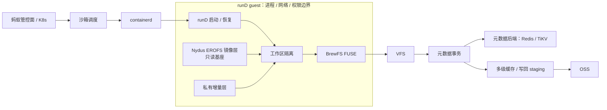
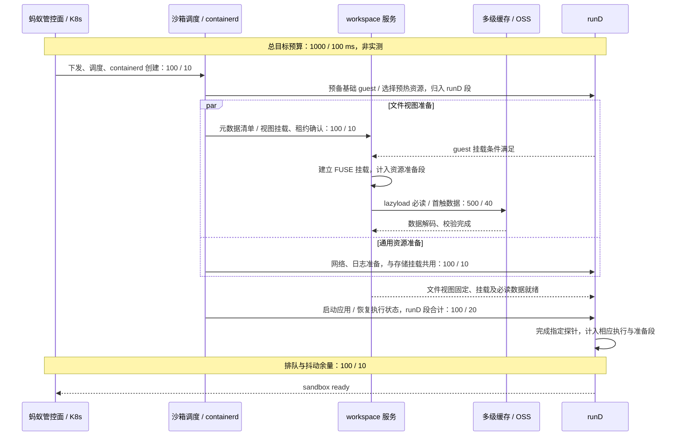
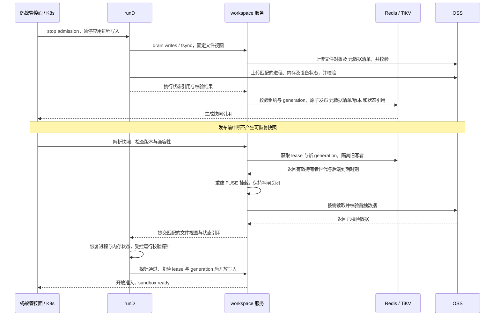
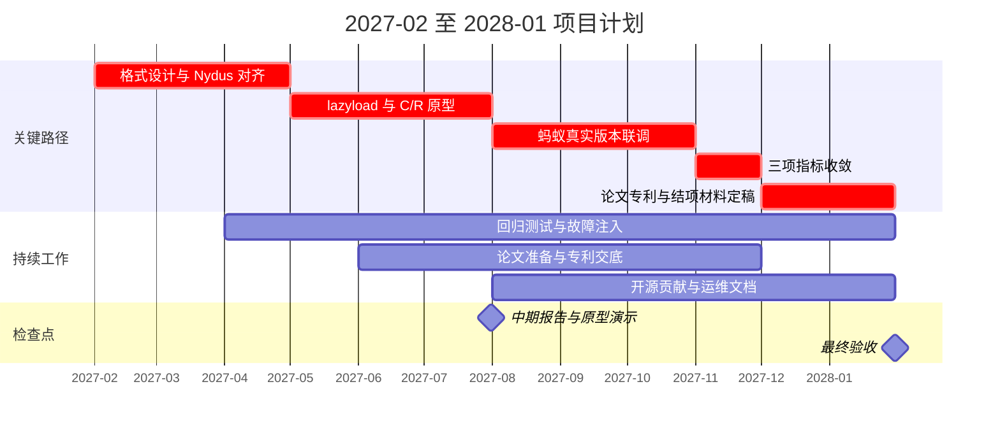

## 一、摘要

BrewFS 是团队主导研发、面向 Agent 负载的 Rust 分布式文件系统，兼容 POSIX 文件接口，原生支持对象存储，元数据与数据分离部署，单进程服务通过 FUSE 用户态文件系统接口挂载，已开源并具备工程与性能基线。本课题聚焦蚂蚁 AI Agent 沙箱冷启动全链路中，镜像完整下载、运行时重复初始化和资源串行准备造成的等待与长尾。拟以工作区隔离（各 Agent 共享只读文件、独立记录自身修改）为切入点，将镜像加载、工作区创建与快照恢复统一到同一套版本与数据路径。

在 2026-09-22 阿里云对齐评测中，同一阿里云规格、同缓存预算且 11 项工具全部通过的条件下，相比 JuiceFS 1.4.1，BrewFS 混合随机 I/O 吞吐约为其 2.5 倍，顺序写吞吐提高 73.6%（均计入写回排空耗时），顺序写、随机写与混合写的后台写回排空为 2–4 秒，对照为 91–127 秒，约快 30 倍以上。

本项目拟将 Nydus EROFS 镜像接入只读基座（多沙箱共享且不可修改的文件集合），以私有增量层（每个沙箱独立记录修改的可写部分）承载工作区变化。研究统一镜像与工作区格式、按需加载与元数据预热、一致持久化的快照保存与恢复（Checkpoint/Restore）、池化预热与并发长尾抑制，由 runD 负责进程、网络与权限隔离。

项目目标为：无本地镜像缓存节点的典型 4G 镜像冷启动由约 10s 降至约 1s；基于已持久化快照和预热资源实现沙箱启动 100ms 级；单机 100 个沙箱并发创建无明显长尾。团队的 Rust 软件质量保障与分布式系统故障复现基础可支撑正确性验证，快照适配与端到端指标仍待本项目验证。

### 项目基本信息

| 项目 | 内容 |
| --- | --- |
| 基金 | 2026 年度 CCF-蚂蚁科研基金（第二批次），CCF 与蚂蚁集团联合设立 |
| 方向 | 超算与智算 |
| 课题 | 面向 AI Agent 沙箱极速冷启动的 Nydus EROFS 按需加载与 Checkpoint/Restore 机制研究 |
| 申请人 | 冯洋，南京大学计算机学院副教授、博士生导师；软件安全与编译技术实验室 |
| 依托单位 | 南京大学 |
| 开源底座 | BrewFS，团队主导的 Rust 分布式文件系统，MIT 许可 |
| 支持金额及周期 | 不超过 30 万元/项；1 年 |
| 申报截止 | 2026-11-11 24:00（北京时间） |
| 结果公布及合同签署 | 2026-12-29；2027-02 中旬 |

### 一句话价值主张

对蚂蚁的价值在于以统一文件视图贯通沙箱的镜像加载、快照恢复和并发调度，预期在典型大镜像启动链路中节省约 9s，并以状态复用和共享读取分别支撑 100ms 级恢复与单机 100 个沙箱并发创建。

## 二、研究背景与问题分析

团队主导的 Rust 分布式文件系统 BrewFS 为统一沙箱文件视图提供了基础，本项目据此研究镜像加载、状态恢复与资源调度之间的协同，减少启动链路中数据与运行状态的重复准备。

### 工作负载与启动链路

Agent 代码执行、工具调用与任务隔离依赖沙箱。短生命周期使创建开销侵占有效执行时间，复杂依赖扩大镜像体积，快速扩缩容增加无缓存节点，批量拉起则放大排队与尾延迟。因此，分析须覆盖管控请求进入系统至任务可执行的全过程。

完整链路包含下表八个环节。表中顺序用于识别责任与阻塞点，实际实现中，无依赖的准备可以并行。

| 环节 | 为什么慢：机制与阻塞位置 |
| --- | --- |
| 管控请求下发 | 请求解析、鉴权、接口转发及状态持久化构成控制面往返。原生 K8s 控制面链路较长，多次事件传递与状态协调使节点收到创建指令前已有等待。 |
| 沙箱调度 | 节点资源与约束匹配、队列等待和绑定确认占据关键路径。若调度不知道镜像块、快照与资源池的位置，可能把任务交给数据未就绪的节点。 |
| 容器管理服务（containerd）创建 | 运行时插件、元数据更新及远程调用（RPC）需要协调。突发并发会竞争锁和队列，垃圾回收（GC）又与前台操作争用处理器、读写及元数据资源，形成批次性抖动。 |
| 镜像准备 | 传统容器镜像先完整拉取再解压，传输与解压写盘均随镜像体积增长。任务仍须等待未使用的数据。按需加载若未预热目录与索引，会把成本转成串行小读。 |
| runD 安全运行时启动 | 从零准备执行环境、初始化资源并启动客体内核，重复支付系统引导及运行时初始化成本。缩短镜像读取不能省去这些计算与设备准备。 |
| 对象存储（OSS）及存储挂载 | 后端连接、挂载建立、元数据查询和首次读取包含远程往返。运行时就绪后才串行执行会累加等待，冷缓存放大首次访问成本。 |
| 网络设备初始化 | 网络命名空间、设备及配置需要主机侧操作。逐实例准备增加系统调用，并发下可能触发内核锁争抢，串行等待还会阻塞应用可达。 |
| 日志初始化 | 日志文件、流、采集通路与后端连接占用元数据及读写资源。若全部同步初始化后才发布就绪，后端排队或写回压力也进入启动时延。 |

上述因素归为五类开销：全量数据搬运与解压、运行时从零初始化、外围资源串行准备、控制面传递与调度等待，以及并发下的锁竞争、远程调用排队和垃圾回收干扰。镜像读取延迟使请求积压，积压又加剧元数据与运行时竞争。表中机制来自课题描述及链路分析，不代表蚂蚁内部各阶段的实测耗时。

### 根本缺口：分别设计导致状态与视图脱节

课题明确指出：**镜像按需加载与运行时状态快照恢复分别设计，缺少统一数据格式、恢复链路与调度协同机制。** 镜像系统定位静态文件块，快照系统记录执行状态。若没有共同版本身份，恢复的进程可能引用与内存状态不对应的文件，或需额外复制、解压、挂载才能重建原路径。缓存和回收生命周期各自管理，还可能导致重复拉取、快照依赖被提前回收，以及调度无法识别可复用状态。

该缺口也涉及正确性。快照发布前若有相关脏数据未持久化，进程状态与文件视图可能不一致。删除工作区若不检查活跃租约，会破坏运行实例。所有权变更后旧挂载继续写入，也可能污染恢复结果。带宽扩容或预热池扩容均不能建立这些跨组件约束。说到底，现有镜像加速和快照恢复是两套机制，缺少共同版本时，就无法明确回答“这个沙箱此刻的文件视图到底是哪个版本”。

### 文件系统视图作为统一抽象的依据与边界

镜像提供只读文件，运行过程产生可写增量，快照恢复要求重建与执行状态匹配的文件集合。三者最终都通过文件系统访问同一命名空间，因而文件系统适合承接版本与生命周期约束。本项目沿用 Nydus EROFS 镜像格式，在文件系统层为镜像、增量与快照赋予共同的版本身份，让加载、创建和恢复能够核对同一份文件视图。

BrewFS 的工作区隔离已由只读基座与私有增量层构成：精确版本号（revision）固定基线，元数据清单（manifest）、内容摘要与校验确定内容。私有增量层中找不到的条目回落到只读基座，删除标记（tombstone）阻止已删除条目重新出现。创建工作区只建立增量元数据与新的可写头，不复制未修改的数据，也不遍历复制目录树。

该结构为 Nydus EROFS 按需加载与快照保存、恢复提供可对接的视图身份，调度可据此判断数据与状态是否就绪。写者租约与代次校验（lease + generation fencing）限定单个写者，并在所有权变更后拒绝旧挂载继续写入。快照、缓存引用与回收仍需围绕同一版本建立协同规则。活动修改由私有增量层承载，封存时再建立可校验的恢复版本，BrewFS 打包快照格式与 Nydus EROFS 的实际映射尚需研究。

BrewFS 只隔离文件视图，进程、网络、权限及客体状态由 runD 等上层组件管理。对接方式包括宿主机工作区服务、客体内 FUSE 挂载及 OSS 后端，跨组件一致快照、恢复适配与资源协同尚未完成。工作区隔离仍为可选功能，运维工具链仍在成熟。写路径尾延迟仍高于对照，已列入优化目标，须在并发创建评测中验证。

对蚂蚁的具体价值在于定位可消除的重复工作：工作区创建免去只读基座中未修改数据的复制及目录树遍历。独立的存储、网络与日志准备，其等待可由耗时之和缩为最长一项，节省量为“各项之和减去最长项”。实际收益须按依赖关系和关键路径核算，为指标分解提供可归因的依据。

## 三、研究目标、关键科学问题与可行性

BrewFS 是团队主导的 Rust 分布式文件系统，已具备工作区隔离、分层缓存与写回能力，并有正确性测试和性能基线。本项目在此基础上统一镜像、工作区与恢复状态的版本，验证课题三条硬指标；以下时间预算均为待验证目标。

### 目标与可判定的科学问题

研究目标是建立可与 runD 协同的 Nydus EROFS 按需加载与快照保存、恢复原型，以 BrewFS 工作区隔离贯通版本、缓存与生命周期管理。

| 关键科学问题：可由实验判定的命题 | 验证方式 |
| --- | --- |
| 统一元数据清单、版本号与写者租约及代次校验 能否使恢复获得匹配快照的文件视图，且拒绝失效写者？ | 注入封存中断、恢复崩溃及租约切换，检查文件摘要、提交可见性与旧写者拒绝结果。 |
| 不复制未修改数据的工作区创建配合按需加载，能否在无本地镜像缓存时将创建路径传输量降低至少 90%，并满足约 1s 就绪？ | 对照完整拉取，清空各级镜像缓存，记录实际传输字节和全链路时延。 |
| 已持久化快照配合首触数据预热，能否在 100ms 预算内完成可执行恢复？ | 对照 runD 从零启动，分别记录快照热度、首触数据量及恢复就绪时刻。 |
| 共享读取、后台隔离及批量提交能否使单机 100 个并发创建的 p99 留在对应启动预算内？ | 逐项消融，注入写回与 垃圾回收压力，记录 p50、p99、最大值、排队及失败。 |

### 三条硬指标的时间预算

推演将“4G”按待传输数据量 4 GiB＝4096 MiB 换算，压缩口径改变时重算；计时从管控接收请求到沙箱能执行指定探针，包含存储、网络和日志必需准备。冷启动清空本地镜像缓存，通用资源池热度单列；快照路径假设快照已一致持久化且必要资源已预热。下表是从总目标拆解的设计预算，单位 ms，并行工作不重复相加；并发列约束单实例冷启动，快照并发另按快照列验证。端到端 p99 须独立统计，不能由各段 p99 相加推得。

| 环节 | 4G 冷启动 | 快照启动 | 100 并发 | 节省机制 |
| --- | ---: | ---: | ---: | --- |
| 管控下发、调度、containerd 创建 | 100 | 10 | 100 | 精简往返、批量提交 |
| 元数据清单与视图接入、租约确认 | 100 | 10 | 100 | 版本索引与元数据预热 |
| 启动必读数据/快照首触数据 | 500 | 40 | 500 | 按需加载、共享读取与缓存 |
| runD 启动/执行状态恢复 | 100 | 20 | 100 | 通用资源池、快照恢复 |
| 存储挂载、网络与日志必需准备 | 100 | 10 | 100 | 独立准备并行、资源复用 |
| 排队与抖动余量 | 100 | 10 | 100 | 前后台隔离 |
| 合计 | 1000 | 100 | 1000 | 待端到端验证 |

**大镜像约 10s → 约 1s。** 2026-09-22 阿里云对齐评测中，BrewFS 实测大文件读为 334.42 MiB/s、顺序读为 1814.4 MiB/s、随机读为 2510.7 MiB/s。即使按后两者直接换算，全量读取仍需约 2.26s、1.63s，尚未计入其他开销，因而必须削减必读字节。暂以 334.42 MiB/s 作为有效读速率假设，500ms 仅容纳 167.21 MiB，即镜像约 4.08%，对应镜像数据约 95.92% 的字节削减，比 90% 的最低目标更严格。该数据额度须涵盖预读与块粒度放大，创建总传输量另计元数据。上述测试含内存及 SSD 缓存，均不能充当冷 OSS 实测速率；实际约束为“必读字节/冷路径有效速率 ≤ 500ms”，其中有效速率须计入传输、解码与校验。工作集超限或 runD 超预算即不达标。

**快照启动 100ms 级。** 40ms 数据预算按上述顺序读、随机读参考速率，分别对应 72.576、100.428 MiB 的吞吐上限估算，仍须扣除恢复协议开销；不代表完整 客体内存可在该时间内读完。需预热必要首触数据，并限制就绪前缺页量。已有写回排空实测为 2—4s，不能计入该恢复预算：相关脏数据必须在快照发布前经持久化屏障完成，镜像/文件视图与执行状态共同提交后才能进入可恢复集合。封存耗时单列，不能通过推迟必需初始化制造快速就绪。

**单机 100 个并发创建无明显长尾。** 若每个实例独立读取 167.21 MiB，以前述假设速率作为节点聚合带宽摊算，仅数据即需 50s；共享同一只读基座且首读重叠时，合并在途请求才可能将共同块压为一次后端读取。共享并不消除各实例私有增量层的提交和 runD 的处理器开销，还须验证节点能否在表中预算内承载该批次，并检查缓存容量与淘汰干扰。2026-11-02 本地小写合并对比显示，写合并使随机写每单位数据量的后端写请求数下降一个数量级（约 94%）。该结果支持减少后端请求，尚不能外推为工作区创建成绩，写路径尾延迟仍列入优化目标。还需将其他工作区的写回、垃圾回收与后台整理移出创建关键路径，实测租约和元数据提交竞争。

上述并发推演以共享基线和重叠首读为条件；异构镜像、非重叠工作集及资源池耗尽必须另测。暂以端到端 p99 及最大值均不突破对应预算、无失败或超时作为操作化目标，最终长尾界限与蚂蚁联合确定。采用自建启动评测框架 对照原始链路，以 fio 定位 I/O 干扰、xfstests 检查文件语义；已有缓存吞吐和本地小写合并结果仅作为机制依据。

对蚂蚁而言，预期把大镜像等待压缩约 9s，将快照恢复关键路径限制在 100ms，并通过共同数据只读取一次、后台干扰不进入创建关键路径支撑并发目标；每项收益均以分段计时、实际字节及尾延迟验收。

## 四、研究内容

BrewFS 是团队主导、已开源的 Rust 分布式文件系统，面向 Agent（智能体）负载，已有工程与性能基线。本课题拟用它隔离沙箱文件视图，统一 Nydus EROFS（只读文件系统格式）镜像加载、工作区创建与快照恢复。以下为研究设计，目标不代表实测。

### 内容一：统一镜像与工作区的版本格式

镜像与工作区分开管理易重复复制、恢复错配。BrewFS 拟以镜像为只读基座（lower），将沙箱修改写入私有增量层（upper），隔离工作区并共享未改数据。创建分支只写精确版本号（revision）的基座引用、元数据头与可写头。因此，无需复制镜像或遍历目录树，创建耗时与镜像体积基本解耦。

BrewFS 拟扩展元数据清单（manifest），记录格式、必需特性、OCI（容器镜像规范）层指纹链、对象指纹、根节点及映射索引。内容指纹（digest）校验数据变化，来源认证仍依赖可信版本引用。导入时核对层序，将镜像中的删除与目录遮蔽信息转换为删除标记（tombstone）及目录回落边界。挂载时核对清单指纹、根节点类型和索引边界，读取时再校验对象，避免拼接不同版本。兼容变更只加可选字段，语义变更生成新版本，比对新旧读取结果后切换。旧程序拒绝未知主版本或必需特性，工作区模式不得回落普通模式，防止改变隔离语义。

BrewFS 先查私有增量层：有效条目直接返回，删除标记返回不存在，仅未命中且允许回落才查只读基座。因此，已删除文件不会从镜像中重现。镜像指纹与节点标识拟确定稳定节点，使硬链接仍指向同一文件。区间索引将文件位置映射到 EROFS 压缩块（pcluster）或增量数据片段。BrewFS 的 64 MiB 数据片、4 MiB 数据块不等同于压缩块。跨边界读取须定位所涉压缩块再组装字节，保证返回正确文件区间。

写时复制（copy-up）拟只建立私有节点和修改区间，保留未修改区间的基座引用，减少小写入的复制量。文件大小内依次读取增量、基座可见范围、空洞零值。`lower_visible_size`（基座可见长度）与增量裁剪在缩短文件时一并提交，再次扩展也不扩大基座可见范围。因此，已截断内容不会重现，局部覆盖仅需补读必要基座数据。

拟以 xfstests（文件系统测试）、pjdfstest（文件语义测试）和故障用例验证删除重建、硬链接、跨压缩块读取和截断后扩展，检查创建写入量是否随镜像增长。对蚂蚁的价值是减少 containerd 准备镜像、runD（安全容器运行时）创建工作区的复制与遍历。结合按需加载，以创建路径传输字节减少 ≥90% 为目标，分别核算元数据、数据与校验开销。

### 内容二：EROFS 语义下的按需加载与元数据预热

首次小读可能因解码拉取过多数据，预填缓存会挤占其他沙箱。BrewFS 拟按需范围读取（range read）：按区间索引定位必要压缩块，按 64 MiB 数据片、4 MiB 数据块布局定位增量对象区间，解码并检查长度、边界后仅返回目标字节。因此，首次读取无需等待完整镜像下载。拟在清单指纹保护的索引中保存压缩块与增量片段的分段校验值，取齐对应区间后校验，失败数据不得缓存。这样可校验局部数据，无需为验证整对象指纹而全量读取；压缩对齐的额外字节计入读放大。

BrewFS 拟将已解码的相邻字节暂存于工作区有容量上限的私有预读区，供顺序读取复用。预读按连续访问和消费比例调整，收益不足即缩减或停用，节省带宽。共享缓存仅在观察到区间复用后，才考虑补齐并缓存完整数据块；只读基座须补齐相关压缩块集合，不改变压缩粒度。因此，单次访问不拉取整片，重复访问则受益于块缓存。其余数据留在对象存储，预测读取与块提升的额外字节单列。

读取先查 Linux 页缓存，未命中经 FUSE（用户态文件系统接口）进入 BrewFS，再查内存、SSD 缓存，最后访问 OSS；私有预读在内存层检查。缓存键绑定对象指纹、区间和编码版本，组装块另绑定文件版本与区间摘要，未提交增量仅本工作区可见，防止版本串读。同一对象区间的并发请求拟合并，复用校验结果，减少往返。实验联动调整单次读取上限、内核读取页数及预读窗口，同时核算节省的往返与增加的传输、解码和排队时间。

挂接视图时拟常驻已验证清单，仅预取根节点、启动索引页和必要映射，省去全目录扫描。空缓存的元数据读取计入冷启动，常驻索引结果另报。以挂接毫秒级为目标，记录首次读取 p99（99% 请求不超过的时延）、命中率、OSS 请求数及读放大，以 fio 和启动轨迹对照立即整块提升、关闭预读等策略。对蚂蚁的价值是缩短挂载与首个任务读取链路，以 4G 镜像无本地缓存冷启动由课题参照约 10s 降至约 1s 为目标，按传输字节验证节省；缓存吞吐不能替代冷存储测量。

### 内容三：Checkpoint/Restore（检查点保存与恢复）的一致固化与快速恢复

BrewFS 拟以检查点标识绑定文件版本与执行状态，避免恢复错配。runD 先暂停执行、阻止新写入，BrewFS 排空在途操作并持久化，再固定文件版本，由 runD 固化配套执行状态。

| 状态类别 | 拟固化的数据布局 | 恢复责任 |
| --- | --- | --- |
| 只读基座 | 元数据清单、内容指纹与根节点引用，复用不可变对象 | BrewFS 校验并挂接 |
| 私有增量层 | 冻结增量组织为 Nydus EROFS 增量包，保存节点、区间索引、删除标记及基座可见长度 | BrewFS 重建视图并创建私有增量层 |
| 执行状态 | runD 导出的进程、内存及相关状态对象，与文件版本共同登记 | runD 校验兼容性并恢复进程、内核与网络 |

BrewFS 拟复用不可变对象，必要重打包在发布前完成；恢复时将冻结增量叠加到原基座，日常写入无需逐次封存或轮换可写头。fsync（持久化同步）成功须代表对象已存入 OSS、校验通过且元数据事务已提交，写回暂存区接收不算完成。目录变更落实目录同步语义，检查点屏障覆盖全部待提交操作，重命名、删除标记与区间更新保持原子事务。全部文件与执行状态对象可读、指纹一致后，才原子发布检查点。因此，崩溃后只能读到旧版或完整新版，未发布对象留待回收。

恢复时，BrewFS 拟固定检查点并校验格式及运行时兼容性，取得新写者租约、推进代次，再挂接视图、创建可写头，由 runD 恢复执行。文件从对象存储直接挂载，后续按需读取，省去全量下载与本地解压。进程、内核和网络由 runD 负责，必需状态装载计入端到端时延，不假定其已支持全部内存按需恢复。

BrewFS 拟以写者租约与代次校验（lease + generation fencing），在每次元数据提交和快照发布时原子核验所有权、有效期与代次，保证每个活跃工作区恰好一个写者。租约失效即停止写入；旧挂载即使上传对象，也无法发布引用。因此，旧挂载不能覆盖新实例数据。索引指向缺失对象须报错，不能补零。回收以已发布快照、活跃工作区和在途上传保护引用为存活依据，删除前复查版本与引用，并以事务使回收与新增引用、恢复保护互斥。上传前登记保护，未发布且无保护的孤儿对象经安全等待再回收，避免误删恢复所需数据。

拟注入上传中断、发布崩溃、租约换代与回收交错，验证一致性。对蚂蚁的价值是免去全量下载、解压并复用运行状态；以快照启动 100ms 级为目标，分别记录预热、无缓存恢复、固化排空时间与下载字节，明确收益边界。

### 内容四：高并发创建的长尾抑制与池化预热

BrewFS 在 2026-09-22 阿里云对齐评测中写吞吐已领先，但前台写尾延迟仍高于对照 JuiceFS。这既是现有短板，也是本项目要解决的问题。批量创建与写回、数据合并及回收争用资源，拟以资源隔离与分层预热减少干扰。工作区隔离仍为可选功能，运维工具尚在成熟；拟先固定 Redis/TiKV（元数据后端）的事务与故障恢复接口，再验证宿主机工作区服务、运行时客体环境内挂载两种路径。

BrewFS 拟分设创建、必需读取与后台队列，按工作区公平分配，为前台预留连接及内存。后台限并发、按可抢占片段执行，写回积压时限制相关工作区产生脏数据，保留后台最低推进能力。因此，创建有资源可用，后台也不会无限积压。持久化同步的等待仍计入请求时延。

元数据更新拟按单操作批量提交，再将独立工作区的发布合并，减少远程调用与提交往返。逐项核验版本、租约及代次，失败按请求唯一标识重试，避免重复执行。限时组批且保持各工作区原子可见，避免低负载请求久等。控制面合并重复版本查询与挂载参数传递，并行准备独立的存储、网络和日志资源，保留所有权校验及失败回滚，缩短串行准备时间。

预热拟分镜像元数据、基座挂接、客体内核和运行时资源设置，复用可安全重置的网络与存储资源。认领时核对镜像指纹与配置，新建私有增量层、取得新租约并重置身份，从而复用初始化成果并隔离残留状态。记录内存、补池成本、命中及耗尽回退；无缓存组清除镜像预热项，披露通用池状态。针对 containerd 回收抖动，拟在接口允许范围内复用不可变内容引用、合并生命周期更新，将非紧急回收错峰限流，减少创建等待；持续核算待回收空间，避免用积压掩盖停顿。

以单机 100 个沙箱并发创建无明显长尾为目标。自建测试框架对照隔离、组批及预热的消融组合，在写回与回收压力下记录中位时延、p99、最大值、失败率及整批耗时。对蚂蚁的价值是减少重复调用、提交和初始化及后台干扰；核算节省的事务、处理器时间与尾延迟，报告池耗尽、异构镜像下的退化。

### 本研究的三点创新

- 拟让 BrewFS 为镜像与工作区统一版本，创建只写元数据头，从而省去镜像复制和目录遍历。
- 拟让加载与恢复共用按需读取、分段校验和缓存规则，从而减少下载与解压等待。
- 拟将先持久化校验、再原子发布与写者租约及代次校验结合，从而保证完整快照可恢复、旧挂载不能续写。

## 五、技术路线与系统架构

BrewFS 是团队主导、面向智能体负载的开源 Rust 分布式文件系统，拟为沙箱隔离文件视图，关联 Nydus EROFS 镜像、增量与 runD 状态，使加载、恢复、创建共用版本及缓存。以下为待验证设计。

### 分层架构

**控制面**接收请求，调度器选节点与资源池，containerd 创建任务并衔接 runD。BrewFS 确认版本及写者资格，配合存储、网络与日志并行准备，减少查询和等待。

**执行面**由 runD 提供客体环境，隔离进程、网络与权限，捕获、恢复执行状态。BrewFS 经 FUSE 提供独立文件视图，与运行时隔离相配合。

**数据面**由 BrewFS 合并只读基座与私有增量层，删除标记防止已删文件重现，创建只写元数据头，省去镜像复制。Redis/TiKV 保存目录、版本及租约，以事务裁定可见性。读取先查页缓存、内存与固态硬盘缓存，再按范围访问 OSS；新增数据暂存写回、提交引用后可见。蚂蚁由此可共享镜像和缓存，同时隔离各沙箱修改。

### 冷启动与恢复预算

图示“4G 冷启动 / 快照启动”预算沿用第三章，单位 ms。冷启动无本地镜像缓存；快照已一致持久化，必要资源与首触数据已预热，成本单列。

网络、日志与文件并行准备，runD 基础环境可先准备，计入运行时段；具备条件后接入 FUSE。版本、租约、挂载、必读数据与执行恢复依序就绪。计时从管控入口收请求开始，分段之和为保守上界，不重复累加重叠时间。

版本、租约和代次有效，挂载、网络及日志可用，网络探针正确返回后才发布就绪；恢复还须核对内存标记与文件指纹。非必需数据继续按需加载，必需初始化不得推迟。蚂蚁由此省去全量下载等待；首触集、池容量和接口开销待联调。

### Checkpoint/Restore 一致性协议

应用暂停后，BrewFS 排空写回并绑定文件与执行状态，先持久化校验、再原子发布，防止暴露半份快照。OSS 保存对象，不假定跨系统事务。日常增量无需逐次封存或轮换可写头，快照独立固定版本；封存不计入恢复预算。拟用 Nydus EROFS 封装状态文件，与 runD 的兼容性待联调。

新实例先建独立文件命名空间，接管须等旧租约失效或撤销。恢复仅运行受控探针，应用准入与写入须在校验通过、复验租约及代次后开放。蚂蚁由此可复用完整状态并拒绝旧挂载续写。

### 关键数据结构

字段用途如下，以已发布版本为准。

| 结构 | 关键字段及约束 |
| --- | --- |
| 只读基座元数据清单 | `format_version`（格式版本）核对兼容性；`root_inode`（根节点）定位入口；`chunk_layout`（数据片布局）、`block_layout`（数据块布局）沿用 64 MiB、4 MiB；`digest`（内容指纹）校验数据变化；`compression_unit_map`（压缩块映射）定位对象范围与校验值，块边界不必一致。 |
| 工作区元数据头 | `namespace_id`（命名空间标识）区分沙箱；`lower_revision`（基座版本）、`lower_digest`（基座指纹）绑定精确基座；`upper_head`（增量头）定位修改；`lifecycle_state`（生命周期状态）记录创建、活跃、恢复或丢弃。 |
| 私有增量层目录条目 | `parent_inode`（父目录节点）、`name`（名称）、`inode`（文件节点）定位条目；`xattr`（扩展属性）保存属性；`tombstone`（删除标记）阻止回落，变更按事务更新。 |
| 数据片段与区间索引 | `file_offset`（文件偏移）、`length`（长度）确定覆盖范围；`object_key`（对象键）、`object_offset`（对象内偏移）定位数据；`digest` 校验内容，`write_revision`（写入版本）确定覆盖次序，截断后禁止旧范围重现。 |
| 写者租约与代次校验 | `holder_id`（持有者标识）、`holder_epoch`（持有者世代）识别写者；`generation`（代次）在所有权切换时递增；`status`（状态）、`backend_expires_at`（后端到期时刻）依后端时间判定有效性。 |
| 恢复意图记录 | `op_id`（操作标识）避免重复执行；`kind`（操作类型）取 `Truncating`（截断）、`Publication`（发布）或 `Discard`（丢弃）；`expected_generation`（预期代次）核对所有权；`base_revision`（基线版本）、`target_revision`（目标版本）标定变更；`phase`（阶段）、`cleanup_cursor`（清理游标）支持分批续做。 |
| 快照引用 | `snapshot_id`（快照标识）、`filesystem_revision`（文件版本）、`runtime_state_ref`（执行状态引用）、`mount_bindings`（挂载绑定）固定匹配的状态与身份，`digest` 校验其内容。 |

元数据变更与引用发布须在事务中核验写者租约及代次。失效挂载的上传对象不可见，未引用对象待回收，阻止旧写者覆盖。

### 失败检测与恢复

| 失败模式 | 检测方式与处理策略 |
| --- | --- |
| 节点崩溃 | 心跳丢失且租约失效后接管，递增代次，从已校验版本重建，排除未提交写入。 |
| 租约过期 | 租约过期、原子续租失败或有效性不明即停写，重新获租后重建挂载。 |
| 对象缺失 | 复核对象键后重试，仍缺失则隔离工作区，从已校验完整版本重建，禁止补零。 |
| 校验失败 | 丢弃指纹不符的缓存并重读 OSS；持续失败则隔离工作区，拒绝就绪和写入。 |
| 并发创建竞争 | 按请求唯一标识复用结果，同目标冲突由原子条件更新裁决；不同目标共享基座，各有增量层和租约。 |
| 恢复中断 | 扫描未完成记录，取得新代次后续做截断、核对发布或按游标清理，保留版本或有效租约引用的数据。 |

版本回退须报告，不得冒充指定快照恢复成功，便于蚂蚁追踪。

### 与蚂蚁技术栈的对接

拟隔离 containerd 的回收与创建队列，由 runD 捕获、恢复执行状态，Nydus 适配镜像解析及按需加载，OSS 持久化对象。BrewFS 承担文件视图、缓存、版本及写者约束，便于蚂蚁联调。

| 可选部署形态 | 取舍 |
| --- | --- |
| 宿主机工作区服务 + 客体内 FUSE 挂载 | 拟先联调，共享缓存与在途读取；须补齐跨边界鉴权、故障隔离及挂载。 |
| 侧车进程 | 服务随沙箱部署，生命周期清晰；进程、缓存及连接成本随实例增加。 |
| 纯远程挂载 | 客体访问远端工作区服务，节点维护少；远程排队与故障影响首次读取。 |

### 工程落地路径

原型保留 `workspace-overlay`（工作区隔离的可选编译开关），坚持 `workspace-v1`（工作区模式）不回落普通模式，完成格式与发布协议，以 xfstests 和故障注入验证。蚂蚁联调补齐生命周期管理、租约感知回收、容量与配额原子计量、网关鉴权及代次传递，验证多客户端竞争、版本兼容与滚动升级，统一部署与回收的写者约束。

收敛阶段验证 1000ms / 100ms 预算及单机 100 个沙箱并发，记录分段耗时、缓存命中、OSS 字节、续租失败及写回排空。隔离写回、回收、数据合并与创建队列，以 fio 和 `.stats`（文件系统计数接口）定位尾延迟干扰，向蚂蚁交付可复核的启动链路、恢复协议及生产化差距清单。

## 六、技术指标与评测方案

本项目围绕三条课题硬指标，建立可复现的微基准与端到端评测，验证 Nydus EROFS、BrewFS 工作区隔离 与 runD 协同优化的实际收益。

### 指标定义与验收映射

以下阈值均为拟验收目标（target），不是已有实测；“约 10s”为课题参照值，基线耗时须重新测量。沿用第三章的 1s／100ms 预算，新增分位数约束用于明确“无明显长尾”。BrewFS 的增量 fork 与已测 I/O 能力提供实现基础，但不能由吞吐直接推导启动时延。Q1 与蚂蚁冻结硬件、版本、负载及口径，不根据结果反向调整阈值。

| 课题指标 | 我们的定义／口径 | 测量方法 | 对照基线 | 验收要求（目标值） |
| --- | --- | --- | --- | --- |
| 4G 镜像冷启动约 10s→1s | 无本地镜像缓存、无预热实例，从管控接收请求到首个有效业务结果 | 同一文件视图分别构建 OCI 与 Nydus EROFS；记录全链路跨度、读取字节 | OCI 全量拉取解压＋runD 从零启动；仅启用 Nydus 按需加载 | 每类典型镜像均须 p99≤1s；创建路径传输字节须比全量拉取减少≥90% |
| 快照启动 100ms 级 | 快照已持久化，必要资源与首触数据已预热；C/R 后状态正确且可执行 | 管控接收恢复请求至状态探针返回；另测无缓存恢复及预热成本 | 全量下载快照后恢复；现有 runD C/R 路径（若支持），热度对齐 | 预热条件下须 p99≤100ms；列全预热内容和成本，单列无缓存恢复结果 |
| 单机 100 沙箱并发创建无明显长尾 | 同一工作节点上 100 个独立创建请求，分别测镜像冷启动与 C/R | 100 worker 屏障释放，记录单请求分布、整批完成时间与失败率 | 相同资源配额下现有创建链路及仅启用按需加载的方案 | 须同时满足 p99/p50≤2、p999/p50≤3；冷启动 p99≤1s、C/R p99≤100ms；全部验收样本均无失败、无超时 |

统一取 t0 为管控入口接收创建/恢复请求的时间，t1 为同一计时端经沙箱网络收到首个确定性业务结果且校验通过的时间，以单调时钟计算 T=t1−t0，包含排队、调度、containerd、镜像准备、runD、存储、网络和日志初始化。harness 另报客户端计划释放至返回的总耗时，暴露入口前排队；不能以进程存活或挂载完成替代 t1。阶段跨度中的重叠区间不累加。快照探针校验预置内存标记和文件摘要，并继续执行一步任务。

### 负载、缓存与采样控制

“4G”按 4 GiB＝4096 MiB 换算。拟选约 4 GiB 的三类真实依赖镜像：Python/PyTorch 推理工具、Chromium/Playwright 浏览器工具、NumPy/Pandas/PyArrow 数据分析；禁止用零填充凑容量。冻结文件清单、OCI/Nydus digest、逻辑与压缩大小、启动命令及输入，记录实际启动工作集，区分逻辑容量和下载量。

每轮单请求或并发批次前，以独立测试节点重建空白缓存盘，重启相关 daemon/guest，清除目标镜像的 containerd 内容、宿主机与 guest page cache、BrewFS 内存/SSD 缓存及 Nydus 缓存；检查目录与命中计数器，禁止只执行 drop_caches。无缓存快照组的状态和索引仅在 OSS；预热快照组在重置后按冻结清单建池并预热首触数据。固定 OSS 路径、地域和带宽，记录服务端缓存不可控边界；通用资源池热度、预热字节及批内共享分别标识。

单请求每组合至少 200 次；并发每组合至少 100 批，每批 100 worker 在 10ms 窗口内释放，批间完全排空并按场景重置。共享只读基座（lower）与重叠首读为主场景，异构镜像、非重叠工作集和池耗尽另测。另按冻结的到达时间戳开放式回放脱敏生产 trace，禁止用“完成后才发下一次”掩盖排队。每组合累计至少 10,000 个并发样本，报告 p50/p95/p99/p999、批次 bootstrap 置信区间和最大值；超时按预设 30s 记失败，不从分布删除，并保留延迟下界。

### 两层评测与消融

微基准用 fio 测 range read、随机小读写、吞吐和 fsync 尾延迟；自建 benchmark harness 测 只读基座 attach、私有增量层（upper）fork、元数据提交、快照固化、恢复与写者租约与代次校验（lease + generation fencing）。以 xfstests、pjdfstest、LTP 验证语义，结合 stress-ng、fuzzing 及故障注入验证崩溃恢复、租约换代和旧写者拒绝。端到端回放从创建到首任务、固定任务完成及资源回收的完整 trace，同时记录 CPU、内存、OSS 请求/字节、GC 停顿和后台队列。

| 消融项（其他配置不变） | 对照实现 | 重点观察 |
| --- | --- | --- |
| 去掉增量层 | 用完整复制替代私有增量层的增量创建 | 创建时延、复制字节、元数据规模 |
| 去掉预热 | 关闭元数据预取及沙箱/网络/存储池化 | 首次读取 p99、attach、恢复 p99 |
| 去掉批量提交 | 逐操作提交，保持相同持久化语义 | RPC/事务数、提交 p99、并发吞吐 |
| 去掉资源隔离 | 创建与写回、GC、compaction 共享队列和配额 | 创建 p99/p999、写尾延迟、GC 抖动 |

预热消融在明确标注的预热实验组执行，4G 无本地镜像缓存冷启动仍独立验收。写负载沿用“完全排空吞吐”：有效字节除以从负载开始至写回、上传和元数据持久化全部完成的墙钟时间；同步报告前台时延及 后台排空时间。预取、建池与快照生成单列时间和资源账单，固定后续任务、观测窗口及后台清空条件，检查重启后可读性，防止把耗时转移到后台。

### 联调与复现交付

在蚂蚁提供的集群及真实 runD/Nydus 版本上复测全部硬指标，冻结内核、containerd、提交号、配额、网络与 OSS 配置；与校内结果分列。交付容器化 runner、种子、参数、镜像构建清单、脱敏 trace、原始时序及分析脚本，使蚂蚁能够复核速度、正确性和资源代价。

## 七、研究计划与里程碑

项目按 2027-02 至 2028-01 的十二个月组织实施，以格式对齐、原型开发、联调、指标收敛及论文专利为关键路径，每季度提交可审查、可运行的阶段成果。

### 季度任务与阶段验收

| 阶段 | 目标与依赖 | 阶段交付物及验收判据 |
| --- | --- | --- |
| Q1：2027-02—04 | 与蚂蚁 Nydus 团队对齐 EROFS、只读基座／私有增量层、元数据清单（manifest）、写者租约与代次校验和 C/R 状态边界；冻结评测约定 | 格式与接口规范 v1、兼容矩阵、三类镜像清单、基线报告及 runner；提交一次按需加载挂载与增量创建的演示脚本和记录，附版本不兼容处理说明 |
| Q2：2027-05—07 | 依赖格式冻结，实现按需加载、快照一致固化、恢复和池化接口；接入批量提交与故障观测 | 原型 v0.1、冷启动/C/R 运行脚本、语义回归与故障注入报告；中期报告附三项指标初测分布、差距清单及后续安排，明确区分初测结果与验收结论 |
| Q3：2027-08—10 | 依赖可运行原型及蚂蚁测试集群，在真实 runD/Nydus 上联调控制面、网络/存储池和后台资源隔离 | 联调版本 v0.2、跨环境复测与消融报告；提交单机 100 并发长尾分析、崩溃及租约换代验证记录、逐项指标收敛台账和论文实验材料 |
| Q4：2027-11—2028-01 | 依赖联调与指标收敛，冻结验收版本，完成论文、专利及成果归档 | 原型 v1.0、三项硬指标验收包、结项验收表/报告、1—2 篇论文底稿及最终收录材料、1 项专利申请号及材料；交付运维说明、上游 PR 和标准化建议 |

### 时间安排与关键路径

中期检查设于 **2027-07-31**，对应基金中期报告要求，集中演示镜像启动和快照恢复，提交格式规范、原型、回归记录、预算执行及风险台账。以“链路可运行、状态可校验、实验可复现”作为中期门槛；性能未收敛项逐一列出负责人和修复期限。

关键依赖为“格式设计与 Nydus 团队对齐→原型→联调→指标收敛→论文与专利定稿”。联调贯穿 Q3，指标收敛延伸至 11 月。论文选题、写作和专利交底提前进行，稳定实验按会期滚动投稿，专利申请先于对应技术公开；收录进度单独跟踪，不以投稿替代最终收录。

2 月上旬安排校内准备，联合实施和费用列支依合同生效时间执行。由 PI 组织每两周技术同步、每月里程碑复核，蚂蚁协调人确认接口、集群和复测窗口；若上游或资源延期，先以固定版本完成可复现适配，再回到真实环境验收。该安排使蚂蚁在中期即可审查原型，后续连续获得可部署版本与指标证据。

## 八、研究基础与团队

BrewFS 是团队主导研发、面向 Agent 负载的 Rust 分布式文件系统，已按 MIT 许可开源，获开放原子旋武社区作为 Rust 开源项目推荐，具备完整工程基线，支撑蚂蚁沙箱快速启动与稳定运行。

### JuiceFS 对齐评测与性能基础

2026-09-22 阿里云对齐评测以 JuiceFS 1.4.1 为对照，采用同一 ECS 规格、镜像、盘型、地域、OSS 内网路径及 fio 负载，双方各配置 **4 GiB 内存缓存＋8 GiB SSD 缓存，11 项工具全部通过**。BrewFS 顺序读、随机读吞吐分别提升 **37.3%、41.6%**；按“完全排空吞吐”口径，顺序写、随机写分别提升 **73.6%、65.8%**，混合随机 I/O 提升 **149.7%（约 2.5 倍）**。

顺序写、随机写及混合写的后台写回排空，BrewFS 为 **2–4 秒**，JuiceFS 为 **91–127 秒**，约快 **30 倍以上**。同样规格、同样缓存预算下，上述负载吞吐为对照的 **1.4–2.5 倍**，写路径的“真正结束时间”快一个数量级以上，支撑 Agent 批量任务周转；沙箱冷启动指标仍须按第六章验收。

### 申请人及研究积累

负责人冯洋为南京大学计算机学院副教授、博士生导师，属软件安全与编译技术实验室。研究主线为：软件质量保障与智能技术，包括 DeepGini（ISSTA 2020）、QATest（ASE 2022）、RediI（ICSE 2025）和 TACO（ICSE 2026），覆盖测试优先级、模糊测试、分布式系统确定性故障复现及大模型可信度评估；语言与软件工程／AI 基础设施，包括 FRIES（ISSTA 2024）、RustGTC（ASE 2026）和 PanicFI（TOSEM 2026），覆盖 Rust 库交互测试、约束引导 API 测试生成及 panic 缺陷修复。团队还在研究分布式文件系统与面向 AI 的异构引擎。

申请人获 3 项 ACM SIGSOFT 杰出论文奖（ASE 2022、ESEC/FSE 2023、Internetware 2023），以及华为火花奖（2024）、技术创新奖（2023）、创新实践奖（2023）、小米青年科技奖（2025）、OpenAtom 旋武社区 2025 贡献奖；具有蚂蚁集团 TuGraph 社区 2024 年度合作伙伴经历，并担任 ICSE 2027、FSE 2027 程序委员会委员。这些积累支撑实现、评估与社区协作。

### BrewFS 技术与工程基础

BrewFS 的 Rust 数据通路为自研 asyncfuse/FUSE→VFS→元数据事务→缓存/写回→对象存储，以不可变数据块组织存储，支持多种元数据后端及 S3 兼容对象服务。拟经 runD guest 内 FUSE 挂载或宿主机侧工作区服务对接蚂蚁栈，共用 OSS 后端，部署边界在 Q1 冻结。

工作区隔离由只读基座与私有增量层组成。按精确版本号（revision）创建工作区，仅建立元数据与可写头，不复制未修改数据或遍历复制目录树。私有增量层保存增量元数据与新数据片段，以删除标记（tombstone）阻止已删除条目回落读取基座，并通过写者租约与代次校验拒绝旧挂载写入。这减少了创建时的数据移动与源目录变动风险。该机制只隔离文件视图，进程、网络和权限由 runD 等上层沙箱负责；完整 C/R 链路将在本项目中研究。

已有工程基线：xfstests **708 个配置用例**通过，覆盖 SQLite、Redis、etcd、TiKV 四种后端 profile；pjdfstest **246 个文件、9134 条断言**通过，覆盖 Redis/TiKV 且无默认排除；LTP 文件系统 profile 四后端通过，并结合 stress-ng、fio、fuzzing 和可复现 Docker Compose runner。新增路径沿用这些工具验证语义、崩溃恢复与并发故障。

写吞吐领先的同时，前台写尾延迟仍高于对照，这与写回策略和后台排空的耦合有关。本项目将降低写尾延迟列为并发长尾抑制的一部分，以批量提交及前后台资源隔离优化。工作区隔离仍为可选编译特性，运维工具链仍在成熟。这些工程补齐工作将与新增路径验证一并推进，支撑蚂蚁联调。

### 人员分工与蚂蚁协作

团队拟按 PI＋2 名博士生＋2 名硕士生配置。博士生 A/B、硕士生 C/D 为角色占位，实际人选在立项后确定，投入时间在启动时落实。

| 角色 | 主要职责 | 可核验责任产物 |
| --- | --- | --- |
| PI 冯洋 | 总体方案、学术质量、对外协调与验收 | 格式评审、阶段报告、论文及专利统筹 |
| 博士生 A | Nydus EROFS、只读基座／私有增量层、按需加载 | 统一格式、增量创建与按需加载模块 |
| 博士生 B | C/R 一致性、写者租约与代次校验、并发优化 | 快照恢复模块、故障注入与尾延迟分析 |
| 硕士生 C | harness、fio 与语义回归、trace 回放 | 复现实验包、原始数据与消融报告 |
| 硕士生 D | containerd/runD 适配、池化、观测及运维 | 联调部署包、资源账单与操作文档 |

依托 TuGraph 社区合作基础，拟由蚂蚁侧协调人组织 Nydus/runD 接口评审与集群复测；按双方流程安排学生实习、联合排障，校内任务持续负责。系统实现与测试验证协同，交付性能可解释、失败可复现、版本可追溯的原型。

## 九、交付成果、经费预算、风险与知识产权

项目围绕课题五类成果验收，统筹原型、实验依据、经费与成果权益安排。

### 交付成果与验收依据

| 类别 | 交付内容 | 验收依据 |
| --- | --- | --- |
| 报告 | 中期报告、结项验收表、结项验收报告 | 问题与方法、指标映射、预算执行、风险处置及复测记录齐全 |
| 论文 | CCF-A 类及蚂蚁认可期刊/会议论文 1—2 篇并最终收录 | 论文底稿与收录邮件；目标渠道提前确认，投稿回执不替代收录 |
| 专利 | 协助蚂蚁和/或关联公司提交国内、国际专利 1 项 | 专利申请号及申请材料；具体申请地域与路径按协议落实 |
| 原型系统 | 一套支持 Nydus EROFS 大镜像按需加载、Nydus EROFS C/R、沙箱池化预热、网络/存储资源池化、控制面精简及运行时高并发优化的系统 | 版本化代码、部署包、接口说明、运维/回滚手册和演示脚本 |
| 技术指标 | 4G 镜像冷启动约 10s→≤1s、快照启动 100ms 级、单机 100 并发无明显长尾 | 按第六章统计口径，在蚂蚁真实 runD/Nydus 环境复测；提交脱敏原始数据及分析脚本 |
| 补充贡献 | BrewFS 上游 PR；统一元数据清单、增量层和 C/R 接口的标准化建议 | PR 链接、评审记录、规范草案及兼容性用例；不将建议稿等同于正式标准 |

### 经费预算

按一年期、多机多盘原型验证和 OSS 请求/流量需求编制，总额 **300,000 元**；下表为申请预算，采购价格及用量为测算假设，不作为既有支出。

| 科目 | 金额（元） | 编制依据与用途 |
| --- | ---: | --- |
| 设备与算力 | 75,000 | 本地测试节点、SSD/盘扩容及计算租用的统筹额度，支撑缓存与故障隔离；不假设已获专用集群 |
| 云资源与对象存储 | 60,000 | 按 5,000 元/月×12 月测算，覆盖云端复测、OSS 容量、请求和流量；与上一科目按资源清单划分，避免重复 |
| 测试与差旅 | 30,000 | 联调测试服务、跨地点排障和阶段验收差旅，按实际计划及票据列支 |
| 劳务／学生助研 | 96,000 | 博士生 A/B：2×2,500 元/月×12 月＝60,000 元；硕士生 C/D：2×1,500 元/月×12 月＝36,000 元 |
| 论文与专利事务 | 27,000 | 论文发表相关费用及专利检索、申请事务测算，具体按协议与实际发生列支 |
| 材料与出版 | 12,000 | 测试耗材、报告印制及成果资料制作，与论文费用分开核算 |
| **合计** | **300,000** | **75,000＋60,000＋30,000＋96,000＋27,000＋12,000** |

预算按四名学生连续参与十二个月测算，PI 不列助研劳务；不将蚂蚁测试资源折算为现金配套。暂按上述项目支出分配，管理或间接费用是否列支以基金合同和学校制度为准；如须计提，在总额内履行调剂程序。云资源设月度用量告警，结合实验窗口控制闲置成本。

### 风险与应对

下表为项目管理触发信号，并非已发生事件；兜底方案仍须记录验收差距，保留原定硬指标。

| 风险 | 触发信号 | 应对动作 | 兜底方案 |
| --- | --- | --- | --- |
| 格式统一受 Nydus 上游演进影响 | 兼容测试失败，或接口评审逾期两周 | 对元数据清单实施版本管理，维护适配层和兼容矩阵 | 固定双方确认版本完成联调，同时提交上游迁移补丁 |
| 工作区隔离运维工具链未成熟 | 挂载残留、回收失败或重复挂载异常 | 补齐幂等挂载/丢弃操作、诊断及回滚工具 | 隔离异常工作区，以已验证版本号重建；保留私有增量层供恢复 |
| 写尾延迟影响创建 | 连续两轮复测中创建 p99 超出验收目标 | 分析写回/GC 争用，调整批量提交和前后台配额 | 回退到已验证参数与同步持久化路径，明确性能损失并继续修复 |
| 多客户端一致性 | 出现双写者、旧代次写入或恢复状态不一致 | 注入租约失效、网络分区和崩溃，审计写者租约与代次校验检查点 | 拒绝无法确认所有权的写入，隔离工作区，从持久化快照恢复 |
| 进度与环境依赖 | 蚂蚁集群/版本窗口或关键任务延期两周 | PI 与协调人重排窗口，先用固定版本校内复现 | 压缩非核心扩展，保留真实环境复测，不以模拟结果替代 |
| 论文与专利交付 | 收录周期超出预期或申请材料退补 | 提前写作、滚动投稿，专利交底与实验并行 | 经确认转投认可渠道并补正申请；必要时按协议处理延期，持续跟踪最终收录 |

### 知识产权与合规

成果论文统一标注：“This work was supported by Ant Group through CCF-Ant Research Fund”。专利归属、申请主体、费用责任及成果使用权按双方协议商定，提交申请与公开披露的顺序同步审查。

BrewFS 既有代码遵循 MIT 许可并保留声明；拟开源新增代码先确认权属和依赖许可。蚂蚁内部代码、配置及数据按协议管理，以接口适配和独立仓库划清边界，不因连接 BrewFS 自动转为 MIT。交付 trace 移除账号、密钥、业务路径及业务内容，保留复现所需时序和负载结构。上述安排为蚂蚁保留可复用的工程成果、可审计的验收依据和明确的权益边界。
