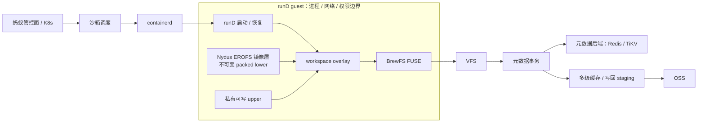
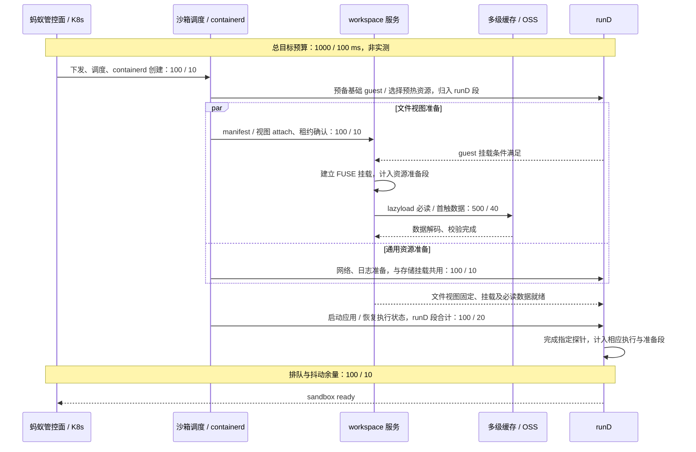
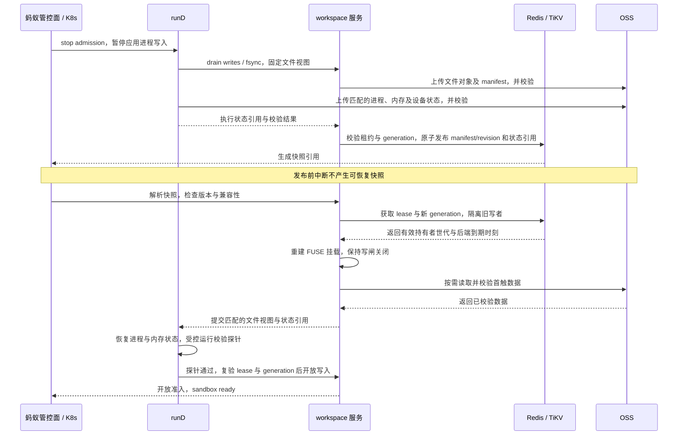

## 05 技术路线与系统架构

本项目拟以团队主导的 BrewFS workspace overlay 关联 Nydus EROFS 镜像、工作区增量与 runD 执行状态，使 lazyload、Checkpoint/Restore 和并发创建共享版本、缓存及生命周期协议。以下接口扩展与时延均为研究设计，不代表现有集成结果。

### 分层架构

管控面接收请求，沙箱调度选择节点和资源池，containerd 创建任务并衔接 runD。  
runD 提供 guest 运行环境，承担进程、网络与权限隔离；BrewFS 仅提供文件视图与数据面。  
Nydus EROFS 镜像拟经格式适配映射为不可变 packed lower，manifest 与数据对象来自 OSS。  
workspace overlay 将 lower 与私有可写 upper 合并；upper 未命中才回落，tombstone 抑制回落，fork 仅建立元数据头，不复制 clean 数据。  
guest 内 BrewFS FUSE 接收文件请求，经 VFS 执行语义；Redis / TiKV 保存命名空间、版本与租约，元数据事务裁定可见性。  
page cache、BrewFS 内存及 SSD 缓存承接读取，未命中按范围访问 OSS；upper 脏数据经 staging 写回为不可变对象，提交引用后可见。

### 冷启动与恢复预算

图中预算按“4G 冷启动 / 快照启动”排列，单位 ms，逐项沿用第 03 章。冷启动无本地镜像缓存；快照已一致持久化，必要资源与首触数据已预热，预热成本单列。

网络、日志与文件准备可并行，runD 基础环境准备可先行，其耗时归入 runD 段；guest 具备挂载条件后方可接入 FUSE。解析版本、确认租约、建立挂载、读取必需数据与执行态恢复存在串行依赖。计时自管控入口接收请求开始；分段之和为保守预算上界，端到端计时不重复累加重叠区间。

“提前发布就绪”仅指无需等待全部对象加载：版本与 fencing 有效、挂载和网络日志可用、指定探针经沙箱网络返回正确结果后，才能发布 sandbox ready。恢复还须校验内存标记与文件摘要；非必需数据继续 lazyload，必需初始化不得推迟。首触集大小、池容量及接口开销待联调标定。

### Checkpoint/Restore 一致性协议

Checkpoint 在应用暂停后排空写回，使文件与执行状态属于同一一致性切面；所有引用对象可读且校验通过，才在元数据后端原子发布。OSS 存放对象，事务只提交引用，不假定跨 OSS 与元数据后端的分布式事务。日常写入不要求 seal、upper head 不轮转；快照发布固定独立 revision。封存耗时不计入恢复预算。拟以 Nydus EROFS 封装状态文件，格式与 runD 恢复接口兼容性待联调标定。

恢复新实例时先从快照 fork 独立 namespace；原 workspace 接管须等待旧租约失效或完成撤销，不抢占有效写者。恢复期间仅运行受控探针，应用准入与写闸均保持关闭。

### 关键数据结构

下表为拟统一的协议字段；可见性以已发布 revision 为准。

| 结构 | 关键字段及约束 |
| --- | --- |
| packed lower manifest | `format_version, root_inode, chunk_layout, block_layout, digest, compression_unit_map`；沿用 64 MiB chunk、4 MiB block 布局，映射逻辑范围至 EROFS 压缩单元、对象范围与校验值，不假定两种边界一致。 |
| workspace 元数据头 | `namespace_id, lower_revision, lower_digest, upper_head, lifecycle_state`；精确绑定 lower，维护创建、活跃、恢复、丢弃状态。 |
| upper 命名空间条目 | `parent_inode, name, inode, xattr, tombstone`；目录项、属性及删除标记在事务中更新。 |
| slice / extent | `file_offset, length, object_key, object_offset, digest, write_revision`；描述增量覆盖区间及次序，截断后禁止旧范围重新显现。 |
| lease + generation fencing | `holder_id, holder_epoch, generation, status, backend_expires_at`；以元数据后端时间判定到期，所有权切换递增 generation。 |
| 恢复意图记录 | `op_id, kind, expected_generation, base_revision, target_revision, phase, cleanup_cursor`；`kind` 为 `Truncating / Publication / Discard`，游标支持分批、幂等清理。 |
| 快照引用 | `snapshot_id, filesystem_revision, runtime_state_ref, mount_bindings, digest`；将文件视图、挂载身份与执行状态共同固定。 |

元数据变更和对象引用发布均在事务中验证 lease + generation fencing。失效挂载即使完成对象上传，也不能使其可见；未引用对象由回收协议处理。

### 失败检测与恢复

| 失败模式 | 检测方式与处理策略 |
| --- | --- |
| 节点崩溃 | 心跳丢失且租约失效后接管；递增 generation，从已校验 revision 重建，未提交写入不冒充持久化数据。 |
| lease 过期 | 后端时间检查或续租 CAS 失败即关闭写闸；无法确认有效性亦拒绝写入，重新获租后重建挂载。 |
| 对象缺失 | 按已提交引用读取失败，复核对象键并重试；仍缺失则隔离 workspace，从完整且已校验 revision 重建，不返回零值伪装成功。 |
| 校验失败 | digest 不符即丢弃对应缓存并重读 OSS；持续失败则隔离 workspace，拒绝就绪和写入。 |
| 并发 fork 竞争 | 以请求幂等键及目标 namespace 唯一约束检测；相同请求复用结果，同目标冲突由 CAS 裁决，不同目标共享只读 lower，各自持有 upper 和租约。 |
| 恢复中断 | 扫描未完成意图及恢复状态，取得新世代后重放；Truncating 续做截断清理，Publication 核对发布点，Discard 依游标清理，均禁止删除仍被版本或有效租约引用的数据。 |

任何回退 revision 的行为均须显式报告，不能将旧状态作为请求快照恢复成功。

### 与蚂蚁技术栈的对接

containerd 负责内容与任务生命周期，研究其 GC 与创建队列隔离；runD 负责隔离、执行状态捕获与恢复；Nydus 负责 EROFS 镜像解析和 lazyload 适配；OSS 提供对象持久化。BrewFS 负责文件视图、缓存、版本事务和写者约束，不接管进程或网络隔离。

| 可选部署形态 | 取舍 |
| --- | --- |
| 宿主机侧 workspace 服务 + guest 内 FUSE 挂载 | 拟作为联调起点，复用节点缓存与在途读取；需完成跨边界请求鉴权、故障隔离和挂载接入。 |
| 侧车进程 | daemon 随沙箱部署，生命周期清晰；进程、缓存与连接成本随实例增加。 |
| 纯远程挂载 | guest 经挂载客户端访问远端 workspace 服务，节点维护较少；RPC 排队及远端故障直接影响首触路径。 |

### 工程落地路径

研究原型阶段保留 opt-in Cargo feature `workspace-overlay`，坚持 `workspace-v1` 不回落 flat 行为，完成格式适配与上述发布协议，以 xfstests 和故障注入验证语义。蚂蚁环境联调阶段补齐 operator 生命周期管理和租约感知回收、statfs 容量与配额原子计量、gateway 鉴权及 fencing 透传，并验证多客户端竞争、版本兼容和滚动升级。

指标收敛阶段用自建 benchmark harness 验证 1000ms / 100ms 预算及单机 100 个沙箱并发；记录分段 trace、缓存命中、OSS 字节、续租失败与写回排空。针对已有前台写尾延迟短板，将写回、GC、compaction 与创建队列隔离，以 fio 定位干扰，结合 `.stats` 核对数据路径。由此向蚂蚁交付可复核的启动链路、失败恢复协议及生产化差距清单。
