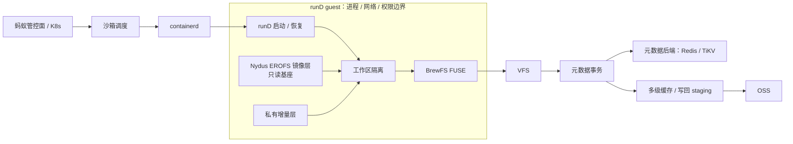
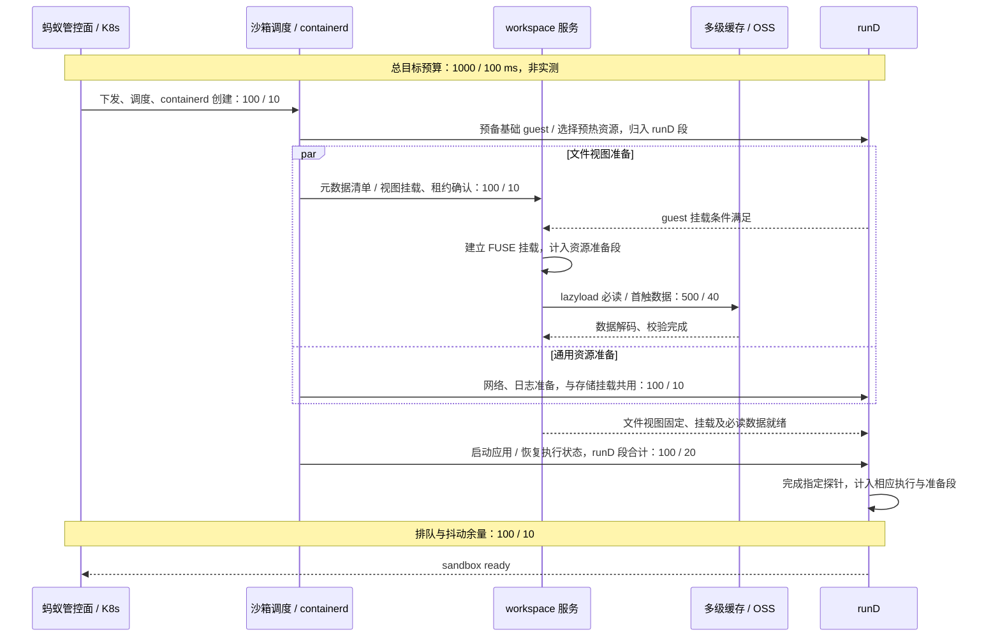
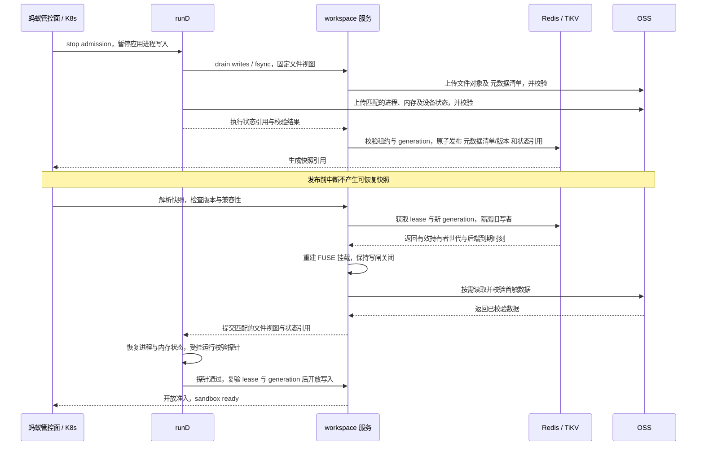

## 05 技术路线与系统架构

BrewFS 是团队主导、面向智能体负载的开源 Rust 分布式文件系统，拟为沙箱隔离文件视图，关联 Nydus EROFS 镜像、增量与 runD 状态，使加载、恢复、创建共用版本及缓存。以下为待验证设计。

### 分层架构

**控制面**接收请求，调度器选节点与资源池，containerd 创建任务并衔接 runD。BrewFS 确认版本及写者资格，配合存储、网络与日志并行准备，减少查询和等待。

**执行面**由 runD 提供客体环境，隔离进程、网络与权限，捕获、恢复执行状态。BrewFS 经 FUSE 提供独立文件视图，与运行时隔离相配合。

**数据面**由 BrewFS 合并只读基座与私有增量层，删除标记防止已删文件重现，创建只写元数据头，省去镜像复制。Redis/TiKV 保存目录、版本及租约，以事务裁定可见性。读取先查页缓存、内存与固态硬盘缓存，再按范围访问 OSS；新增数据暂存写回、提交引用后可见。蚂蚁由此可共享镜像和缓存，同时隔离各沙箱修改。

### 冷启动与恢复预算

图示“4G 冷启动 / 快照启动”预算沿用第 03 章，单位 ms。冷启动无本地镜像缓存；快照已一致持久化，必要资源与首触数据已预热，成本单列。

网络、日志与文件并行准备，runD 基础环境可先准备，计入运行时段；具备条件后接入 FUSE。版本、租约、挂载、必读数据与执行恢复依序就绪。计时从管控入口收请求开始，分段之和为保守上界，不重复累加重叠时间。

版本、租约和代次有效，挂载、网络及日志可用，网络探针正确返回后才发布就绪；恢复还须核对内存标记与文件指纹。非必需数据继续按需加载，必需初始化不得推迟。蚂蚁由此省去全量下载等待；首触集、池容量和接口开销待联调。

### Checkpoint/Restore 一致性协议

应用暂停后，BrewFS 排空写回并绑定文件与执行状态，先持久化校验、再原子发布，防止暴露半份快照。OSS 保存对象，不假定跨系统事务。日常增量无需逐次封存或轮换可写头，快照独立固定版本；封存不计入恢复预算。拟用 Nydus EROFS 封装状态文件，与 runD 的兼容性待联调。

新实例先建独立文件命名空间，接管须等旧租约失效或撤销。恢复仅运行受控探针，应用准入与写入须在校验通过、复验租约及代次后开放。蚂蚁由此可复用完整状态并拒绝旧挂载续写。

### 关键数据结构

字段用途如下，以已发布版本为准。

| 结构 | 关键字段及约束 |
| --- | --- |
| 只读基座元数据清单 | `format_version`（格式版本）核对兼容性；`root_inode`（根节点）定位入口；`chunk_layout`（数据片布局）、`block_layout`（数据块布局）沿用 64 MiB、4 MiB；`digest`（内容指纹）校验数据变化；`compression_unit_map`（压缩块映射）定位对象范围与校验值，块边界不必一致。 |
| 工作区元数据头 | `namespace_id`（命名空间标识）区分沙箱；`lower_revision`（基座版本）、`lower_digest`（基座指纹）绑定精确基座；`upper_head`（增量头）定位修改；`lifecycle_state`（生命周期状态）记录创建、活跃、恢复或丢弃。 |
| 私有增量层目录条目 | `parent_inode`（父目录节点）、`name`（名称）、`inode`（文件节点）定位条目；`xattr`（扩展属性）保存属性；`tombstone`（删除标记）阻止回落，变更按事务更新。 |
| 数据片段与区间索引 | `file_offset`（文件偏移）、`length`（长度）确定覆盖范围；`object_key`（对象键）、`object_offset`（对象内偏移）定位数据；`digest` 校验内容，`write_revision`（写入版本）确定覆盖次序，截断后禁止旧范围重现。 |
| 写者租约与代次校验 | `holder_id`（持有者标识）、`holder_epoch`（持有者世代）识别写者；`generation`（代次）在所有权切换时递增；`status`（状态）、`backend_expires_at`（后端到期时刻）依后端时间判定有效性。 |
| 恢复意图记录 | `op_id`（操作标识）避免重复执行；`kind`（操作类型）取 `Truncating`（截断）、`Publication`（发布）或 `Discard`（丢弃）；`expected_generation`（预期代次）核对所有权；`base_revision`（基线版本）、`target_revision`（目标版本）标定变更；`phase`（阶段）、`cleanup_cursor`（清理游标）支持分批续做。 |
| 快照引用 | `snapshot_id`（快照标识）、`filesystem_revision`（文件版本）、`runtime_state_ref`（执行状态引用）、`mount_bindings`（挂载绑定）固定匹配的状态与身份，`digest` 校验其内容。 |

元数据变更与引用发布须在事务中核验写者租约及代次。失效挂载的上传对象不可见，未引用对象待回收，阻止旧写者覆盖。

### 失败检测与恢复

| 失败模式 | 检测方式与处理策略 |
| --- | --- |
| 节点崩溃 | 心跳丢失且租约失效后接管，递增代次，从已校验版本重建，排除未提交写入。 |
| 租约过期 | 租约过期、原子续租失败或有效性不明即停写，重新获租后重建挂载。 |
| 对象缺失 | 复核对象键后重试，仍缺失则隔离工作区，从已校验完整版本重建，禁止补零。 |
| 校验失败 | 丢弃指纹不符的缓存并重读 OSS；持续失败则隔离工作区，拒绝就绪和写入。 |
| 并发创建竞争 | 按请求唯一标识复用结果，同目标冲突由原子条件更新裁决；不同目标共享基座，各有增量层和租约。 |
| 恢复中断 | 扫描未完成记录，取得新代次后续做截断、核对发布或按游标清理，保留版本或有效租约引用的数据。 |

版本回退须报告，不得冒充指定快照恢复成功，便于蚂蚁追踪。

### 与蚂蚁技术栈的对接

拟隔离 containerd 的回收与创建队列，由 runD 捕获、恢复执行状态，Nydus 适配镜像解析及按需加载，OSS 持久化对象。BrewFS 承担文件视图、缓存、版本及写者约束，便于蚂蚁联调。

| 可选部署形态 | 取舍 |
| --- | --- |
| 宿主机工作区服务 + 客体内 FUSE 挂载 | 拟先联调，共享缓存与在途读取；须补齐跨边界鉴权、故障隔离及挂载。 |
| 侧车进程 | 服务随沙箱部署，生命周期清晰；进程、缓存及连接成本随实例增加。 |
| 纯远程挂载 | 客体访问远端工作区服务，节点维护少；远程排队与故障影响首次读取。 |

### 工程落地路径

原型保留 `workspace-overlay`（工作区隔离的可选编译开关），坚持 `workspace-v1`（工作区模式）不回落普通模式，完成格式与发布协议，以 xfstests 和故障注入验证。蚂蚁联调补齐生命周期管理、租约感知回收、容量与配额原子计量、网关鉴权及代次传递，验证多客户端竞争、版本兼容与滚动升级，统一部署与回收的写者约束。

收敛阶段验证 1000ms / 100ms 预算及单机 100 个沙箱并发，记录分段耗时、缓存命中、OSS 字节、续租失败及写回排空。隔离写回、回收、数据合并与创建队列，以 fio 和 `.stats`（文件系统计数接口）定位尾延迟干扰，向蚂蚁交付可复核的启动链路、恢复协议及生产化差距清单。
