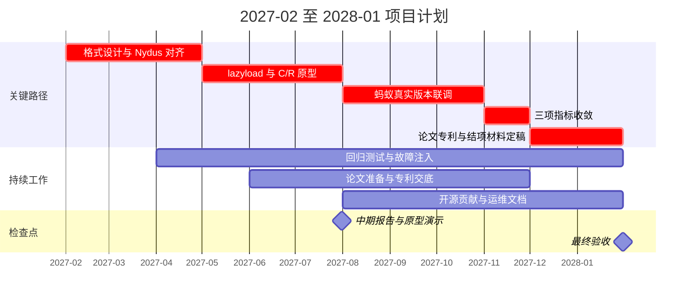

## 07 研究计划与里程碑

项目按 2027-02 至 2028-01 的十二个月组织实施，以格式对齐、原型开发、联调、指标收敛及论文专利为关键路径，每季度提交可审查、可运行的阶段成果。

### 季度任务与阶段验收

| 阶段 | 目标与依赖 | 阶段交付物及验收判据 |
| --- | --- | --- |
| Q1：2027-02—04 | 与蚂蚁 Nydus 团队对齐 EROFS、只读基座／私有增量层、元数据清单（manifest）、写者租约与代次校验和 C/R 状态边界；冻结评测约定 | 格式与接口规范 v1、兼容矩阵、三类镜像清单、基线报告及 runner；提交一次按需加载挂载与增量创建的演示脚本和记录，附版本不兼容处理说明 |
| Q2：2027-05—07 | 依赖格式冻结，实现按需加载、快照一致固化、恢复和池化接口；接入批量提交与故障观测 | 原型 v0.1、冷启动/C/R 运行脚本、语义回归与故障注入报告；中期报告附三项指标初测分布、差距清单及后续安排，明确区分初测结果与验收结论 |
| Q3：2027-08—10 | 依赖可运行原型及蚂蚁测试集群，在真实 runD/Nydus 上联调控制面、网络/存储池和后台资源隔离 | 联调版本 v0.2、跨环境复测与消融报告；提交单机 100 并发长尾分析、崩溃及租约换代验证记录、逐项指标收敛台账和论文实验材料 |
| Q4：2027-11—2028-01 | 依赖联调与指标收敛，冻结验收版本，完成论文、专利及成果归档 | 原型 v1.0、三项硬指标验收包、结项验收表/报告、1—2 篇论文底稿及最终收录材料、1 项专利申请号及材料；交付运维说明、上游 PR 和标准化建议 |

### 时间安排与关键路径

中期检查设于 **2027-07-31**，对应基金中期报告要求，集中演示镜像启动和快照恢复，提交格式规范、原型、回归记录、预算执行及风险台账。以“链路可运行、状态可校验、实验可复现”作为中期门槛；性能未收敛项逐一列出负责人和修复期限。

关键依赖为“格式设计与 Nydus 团队对齐→原型→联调→指标收敛→论文与专利定稿”。联调贯穿 Q3，指标收敛延伸至 11 月。论文选题、写作和专利交底提前进行，稳定实验按会期滚动投稿，专利申请先于对应技术公开；收录进度单独跟踪，不以投稿替代最终收录。

2 月上旬安排校内准备，联合实施和费用列支依合同生效时间执行。由 PI 组织每两周技术同步、每月里程碑复核，蚂蚁协调人确认接口、集群和复测窗口；若上游或资源延期，先以固定版本完成可复现适配，再回到真实环境验收。该安排使蚂蚁在中期即可审查原型，后续连续获得可部署版本与指标证据。
